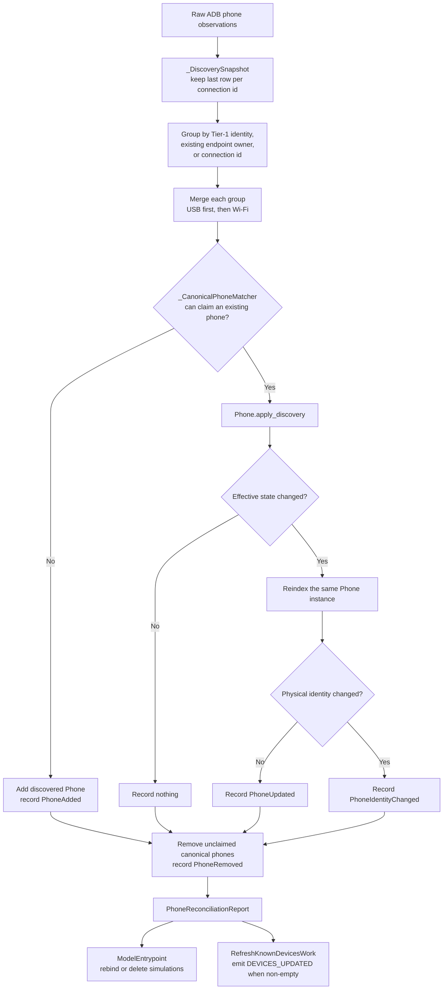

# How device reconciliation works

This guide explains how AROW turns a fresh `adb devices` snapshot into the
canonical set of physical phones used by simulations and the GUI. It follows the
implementation in `src/core/devices/reconciliation.py` and the aggregate rules in
`src/core/devices/phone.py`.

Read this with [`HOW_TO_async_jobs.md`](HOW_TO_async_jobs.md) when you need the
worker-thread flow that produces and applies the discovery snapshot.

## Mental model

Reconciliation does not replace the repository with newly allocated `Phone`
objects. It preserves the canonical `Phone` instance whenever discovery can
safely prove that an observation represents the same physical handset.

Four domain objects divide the work:

| Object | Question it answers |
|---|---|
| `_DiscoverySnapshot` | Which ADB rows describe the same physical phone? |
| `_CanonicalPhoneMatcher` | Which existing repository phone may this discovery group update? |
| `Phone.apply_discovery(...)` | Did applying this complete snapshot change the aggregate? |
| `_PhoneChangeJournal` | Which meaningful events must downstream code handle? |

`ReconciliationEngine` only coordinates those objects. Repository ownership,
phone mutation, and downstream effects remain separate responsibilities.

## Workflow

The following flowchart is UML-like rather than formal UML. Mermaid is the source
format so the diagram stays reviewable beside the code.



Text alternative: normalize and group discovery rows, claim at most one existing
phone for each group, apply the group to that canonical instance, remove existing
phones that were never claimed, then expose the ordered changes to simulations
and the device-list refresh flow.

## Snapshot rules

### Deduplicate by ADB connection

ADB may report the same connection identifier more than once in one refresh.
`_DiscoverySnapshot` keeps the last observation for that identifier. This makes a
later `offline` row override an earlier `device` row from the same snapshot.

### Group only with strong evidence

Each remaining observation receives one `_PhoneGroupKey`. The first applicable
rule wins:

1. A Tier-1 stable key such as `hw:v1:SERIAL-1` groups every endpoint belonging
   to that physical handset.
2. Without a Tier-1 key, an endpoint already indexed by `PhoneRepository` groups
   with its existing owner.
3. Without either form of evidence, the ADB connection id forms its own group.

Tier-2 keys beginning with `fp:v1:` are fingerprints of descriptive metadata.
Two identical handset models may share one, so reconciliation never uses them to
merge or rebind physical phones.

### Build one discovery aggregate

Within a group, USB observations sort before Wi-Fi observations, then by
connection id. The first observation becomes the primary `Phone`; later
observations contribute their connections and the first available enrichment
values. The result is one discovery aggregate containing the complete connection
snapshot for that refresh.

## Matching rules

`_CanonicalPhoneMatcher` captures the repository indexes before any mutation and
claims each canonical phone at most once. It tries these matches in order:

1. Exact physical `PhoneIdentity`.
2. A unique canonical owner of one of the discovered ADB connections.
3. An unclaimed phone with the same Tier-1 stable key.
4. No match, which means the discovered aggregate is added as a new phone.

This priority keeps common refreshes cheap, allows a provisional phone to gain a
Tier-1 identity through its known endpoint, and allows a known handset to
reconnect under a different ADB endpoint without replacing the canonical object.

## Applying discovery

`Phone.apply_discovery(...)` owns the mutation and reports whether effective
state changed. It replaces the complete connection snapshot, metadata, and any
non-provisional physical identity while preserving these invariants:

- An inactive observation preserves the last known active timestamp for the same
  endpoint.
- A provisional discovery identity cannot replace an established identity.
- A preferred connection remains selected while it still exists and is active.
- Otherwise the command target falls back deterministically to active USB, then
  active Wi-Fi.
- The display name is recomputed after the final target and metadata are known.

If identity, descriptor, and connections are all effectively unchanged,
`apply_discovery(...)` returns `False` and reconciliation emits no event.

## Change report

`PhoneReconciliationReport` contains one ordered tuple of domain events:

| Event | Meaning |
|---|---|
| `PhoneAdded(phone_id)` | A previously unknown physical phone entered the repository. |
| `PhoneUpdated(phone_id)` | The canonical phone changed without changing physical identity. |
| `PhoneIdentityChanged(previous_phone_id, current_phone_id)` | The same canonical object moved to a new physical identity key. |
| `PhoneRemoved(phone_id)` | A canonical phone was absent from the complete snapshot. |

An empty journal means a no-op. Discovery events keep snapshot order; removal
events follow repository order.

`ModelEntrypoint.reconcile_paired_devices(...)` consumes identity changes and
removals to rebind or delete simulations. `RefreshKnownDevicesWork` converts the
identity-change events into the existing GUI payload mapping and emits
`DEVICES_UPDATED` only when the report contains at least one event.

## Example: one phone reconnects over USB and Wi-Fi

This scenario mirrors the regression coverage in
`src/core/tests/test_reconciliation_engine.py`.

### Before discovery

The repository owns one canonical phone:

```text
Phone object:       phone_A
Physical identity:  phone:v1:provisional:a1b2c3
Connections:        usb-1 (device)
Simulation:         simulation_42 -> phone_A
```

The provisional identity means enrichment has not yet provided a collision-safe
hardware serial. The simulation holds the actual `phone_A` object.

### New ADB snapshot

The refresh discovers two active endpoints and shell enrichment reports the same
hardware serial for both:

```text
USB observation
  connection:       usb-1
  transport:        USB
  state:            device
  hardware serial:  SERIAL-1
  Tier-1 key:       hw:v1:SERIAL-1

Wi-Fi observation
  connection:       wifi-1
  transport:        Wi-Fi
  state:            device
  hardware serial:  SERIAL-1
  Tier-1 key:       hw:v1:SERIAL-1
```

### Reconciliation, step by step

1. `_DiscoverySnapshot` groups both observations by `hw:v1:SERIAL-1`.
2. USB becomes the primary observation; Wi-Fi contributes `wifi-1`.
3. Exact physical identity does not match because `phone_A` is still
   provisional.
4. Endpoint ownership does match: the repository already knows that `usb-1`
   belongs to `phone_A`.
5. The matcher claims `phone_A`; no new `Phone` is allocated for the repository.
6. `phone_A.apply_discovery(...)` installs both endpoints and promotes the
   identity to `hw:v1:SERIAL-1`.
7. `PhoneRepository.reindex(...)` removes the provisional key and indexes the
   same object under the Tier-1 key and both connection ids.
8. The journal records exactly one event:

```python
PhoneIdentityChanged(
    previous_phone_id="phone:v1:provisional:a1b2c3",
    current_phone_id="hw:v1:SERIAL-1",
)
```

9. `ModelEntrypoint` rebinds `simulation_42` to the new identity. Its device
   reference is still `phone_A`.
10. The refresh flow emits the unchanged GUI payload shape:

```python
{"phone:v1:provisional:a1b2c3": "hw:v1:SERIAL-1"}
```

### Result

```text
Phone object:       phone_A (same instance)
Physical identity:  hw:v1:SERIAL-1
Connections:        usb-1 (device), wifi-1 (device)
Command target:     usb-1
Simulation:         simulation_42 -> phone_A
Report:             one PhoneIdentityChanged event
```

## Common outcomes

| Observation | Result |
|---|---|
| Identical inactive snapshot | No event; no device-list signal. |
| Active endpoint observed again with a newer timestamp | `PhoneUpdated`; the device list refreshes. |
| Active endpoint becomes offline | `PhoneUpdated`; its prior active timestamp is retained. |
| Known Tier-1 phone appears under a new ADB id | Same canonical object, replaced connection snapshot, `PhoneUpdated`. |
| Tier-2 lookalike appears under another id | Separate phone; no identity rebinding. |
| Canonical phone is absent from the complete snapshot | `PhoneRemoved`; its simulation is deleted best-effort. |

## Where to make changes

- Reconciliation pipeline and events: `src/core/devices/reconciliation.py`
- Phone snapshot application and connection targeting: `src/core/devices/phone.py`
- Repository indexes: `PhoneRepository` in `src/core/devices/phone.py`
- Simulation side effects: `ModelEntrypoint.reconcile_paired_devices(...)` in
  `src/core/entrypoint.py`
- GUI update application: `RefreshKnownDevicesWork.apply_main_thread(...)` in
  `src/core/work/refresh_known_devices_work.py`

Behavioral tests live in:

- `src/core/tests/test_reconciliation_engine.py`
- `src/core/tests/test_phone.py`
- `src/core/tests/test_entrypoint_reconcile.py`
- `src/core/work/tests/test_refresh_known_devices_work.py`

When changing a rule, update the closest domain test first, then run the focused
reconciliation tests and the complete suite because identity and event semantics
cross persistence, simulation, and GUI boundaries.
