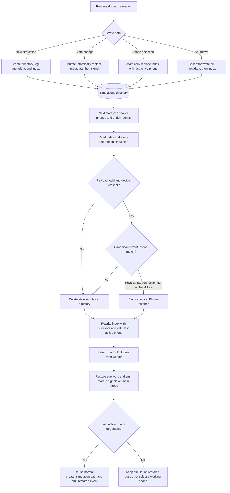

# How simulation persistence works

This guide explains how AROW writes simulation state, restores it on startup,
rebinds it to the current `Phone` objects, and removes state that can no longer
be trusted. It is intended as the maintainer-level map of the persistence
workflow.

The source of truth is split across
[`simulation.py`](../src/core/simulation.py),
[`simulation_service.py`](../src/core/simulation_service.py), and
[`startup_work.py`](../src/core/work/startup_work.py).

## Mental model

| Component | Responsibility |
|---|---|
| `Simulation` | Mutable runtime state and JSON serialization for one simulation. |
| `SimulationRepository` | Canonical in-memory collection and repository-level persistence operations. |
| `SimulationDiskStore` | JSON, artifact paths, directory cleanup, and startup device rebinding. |
| `SimulationService` | Domain mutations, incremental persistence, and core signal emission. |
| `StartupCoreRuntimeWork` | Worker-thread ADB startup and disk restore, followed by main-thread model application. |
| Controllers | Request domain operations and react to core signals; they never write persistence JSON directly. |

Two files answer different questions:

- `index.json` says **which simulations belong to the repository** and which
  physical phone was selected last.
- Each `simulation.json` says **what one simulation contains**, including the
  phone snapshot needed to find its current canonical `Phone` after a restart.

The index is authoritative. A simulation directory that is not listed in
`index.json` is an orphan: startup neither restores nor deletes it.

## On-disk layout

Simulation data lives under the application data directory:

```text
<application_dir>/simulations/
  index.json
  <simulation_id>/
    simulation.json
    <simulation_id>.log
    map/
      <simulation_id>.html
```

`index.json` uses schema version `1`:

```json
{
  "schema_version": 1,
  "simulations": ["sim-rail-42"],
  "last_active_device_id": "hw:v1:SER-123"
}
```

Each `simulation.json` also uses schema version `1` and stores:

- `schema_version`
- `id`
- `device`, as a serialized phone snapshot with its physical identity,
  descriptor, and ADB connections
- `real_location`
- `spoofed_location`
- `map_file`
- `log_file`
- `active`

`map_file` and `log_file` are stored relative to their simulation directory
when possible. A path outside that directory is retained as an absolute path
and produces a warning.

## Workflow diagram



Text equivalent: runtime mutations are persisted before their signals, while
startup first discovers the current phones, loads only index-referenced
simulations, validates and rebinds each survivor, rewrites a cleaned index, and
only then applies the result to the main-thread model. Invalid or unbound
simulations are deleted during that scan.

## Runtime write paths

### Create or select a simulation

`ModelEntrypoint.create_simulation(device_id)` requires an initialized ADB
server and client and a phone present under that physical identity.

For a new phone simulation, `SimulationRepository.add(...)`:

1. Adds the exact `Simulation` instance to memory.
2. Creates its directory.
3. Creates `<simulation_id>.log` and writes the creation timestamp.
4. Atomically writes `simulation.json`.
5. Atomically rewrites `index.json`.

For a phone that already has a simulation, the service reuses that simulation
and emits `SIMULATION_RESTORED`; it does not create a duplicate. In both cases,
the selected physical phone identity becomes `last_active_device_id` and the
index is rewritten.

### Mutate active state, locations, or map path

`SimulationService` owns the typed mutation operations for:

- `active`
- `real_location`
- `spoofed_location`
- `map_file`

An effective change updates memory and attempts to atomically replace that
simulation's metadata. The active-state, location, and assigned-map operations
then emit their related core signals. Clearing a failed map path is persisted
without a separate map-file-changed signal; the render workflow emits
`MAP_RENDER_FAILED`. An unchanged value is a no-op and produces no write.

Incremental persistence is intentionally best-effort. If a write fails, AROW
logs the exception but retains the in-memory mutation and still emits the
signal. Runtime state therefore remains usable, although disk may lag until a
later successful write or shutdown.

### Delete a simulation

Removal is instance-safe: the repository accepts only the exact stored
`Simulation` object. A successful removal deletes the simulation directory and
then rewrites the index. A different object with the same simulation ID is
rejected without changing memory or disk.

### Persist at shutdown

`AppController` asks `SimulationSubController` to persist the repository during
normal finalization and forced close. The store writes every `simulation.json`
first and `index.json` last. Shutdown catches and logs persistence failures so
they do not prevent teardown.

All JSON writes use a sibling `*.tmp` file followed by `Path.replace(...)`.
This prevents readers from observing partially written JSON; it does not make a
multi-file repository update transactional.

## Startup restore workflow

`StartupCoreRuntimeWork.run()` performs the blocking work off the Qt main
thread:

1. Start ADB and build the current paired-phone repository.
2. Enrich targetable phones with shell properties, including stable identity.
3. Read the simulation index.
4. Deserialize each simulation named by the index.
5. Bind every valid simulation to one canonical phone already held by the
   paired-phone repository.
6. Delete each referenced simulation directory that is invalid or cannot be
   bound.
7. Rewrite the index with only the survivors and a valid
   `last_active_device_id`.
8. Return the ADB runtime, phones, simulations, and last-active identity in a
   `StartupOutcome`.

`StartupCoreRuntimeWork.apply_main_thread(...)` then:

1. Installs the ADB server and client on `ModelEntrypoint`.
2. Restores the loaded `Simulation` instances into the in-memory repository
   without creating new disk artifacts.
3. Emits `ADB_SERVER_STARTED` and `DEVICES_UPDATED`.
4. Synchronizes `last_active_device_id` in memory without another index write.
5. If that physical phone still has a targetable ADB connection, calls the
   ordinary `create_simulation(...)` path. The existing simulation is reused,
   `SIMULATION_RESTORED` is emitted, and normal UI selection behavior follows.

An offline or unauthorized last-active phone can still have its simulation
restored, but startup does not select it as the working phone.

## Phone matching and recovery rules

The serialized `device` is a discovery snapshot, not the canonical phone
object. Restore resolves it against the current `PhoneRepository` in this
order:

| Priority | Match | Why it is safe |
|---:|---|---|
| 1 | Persisted physical `PhoneIdentity` | Direct match to the repository's primary key. |
| 2 | Any persisted ADB connection ID | Supports legacy endpoint identities and reconnects through the repository's secondary connection index. |
| 3 | Parsed Tier-1 `FirstTierStableKey` | Collision-resistant hardware identity can survive changed ADB endpoints. |
| 4 | No match | The simulation is stale and its directory is deleted. |

Tier-2 fingerprints never rebind persisted simulations because similar device
metadata is not strong enough to prove physical identity.

On a match, `simulation.device` is replaced with the exact canonical `Phone`
instance from the current repository. If `last_active_device_id` referred to
the persisted phone identity or one of its old endpoints, it is promoted to the
canonical physical identity. The cleaned index is written immediately. The
rebound phone snapshot reaches `simulation.json` on a later incremental or bulk
write; startup does not rewrite every surviving metadata file by itself.

AROW deletes an index-referenced simulation directory when:

- `simulation.json` is missing or is not a JSON object;
- the JSON cannot be parsed;
- its schema version is unsupported;
- required location payloads are missing or deserialization raises a handled
  `TypeError` or `ValueError`;
- its device is absent; or
- no current phone matches under the rules above.

After the scan, the index lists only successfully loaded simulations. A
`last_active_device_id` that resolves to neither a current physical identity nor
a current connection ID is cleared to `null`.

A malformed or unsupported index is treated as an empty index and is replaced
with a valid empty one during the load pass. Because only indexed IDs are
scanned, any directories that became orphaned from that damaged index remain on
disk. Unexpected deserialization exceptions outside the handled
`TypeError`/`ValueError` path propagate and fail startup work rather than being
silently discarded.

## Runtime device reconciliation after startup

Later ADB refreshes use the workflow described in
[`HOW_TO_device_reconciliation.md`](HOW_TO_device_reconciliation.md).
Persistence reacts to its semantic events:

- A phone updated in place keeps the same object, so its simulation remains
  attached automatically.
- A provisional identity promoted to Tier-1 causes `SimulationService` to
  rebind `last_active_device_id` and persist affected simulations.
- A removed phone causes its simulation, directory, and index entry to be
  removed when such a simulation exists.

This is distinct from startup matching: startup reconstructs relationships
from disk, while runtime reconciliation preserves relationships through
canonical object identity.

## Map cache behavior

`RenderMapWork` writes HTML to:

```text
<application_dir>/simulations/<simulation_id>/map/<simulation_id>.html
```

After a successful render, the main-thread mutation stores and persists
`simulation.map_file`. On a later request, `MapSubController` forwards the
cached path directly when the file still exists; otherwise it submits a new
render job. A render failure clears and persists `map_file` before
`MAP_RENDER_FAILED` is emitted.

The metadata path is therefore only a cache pointer. The HTML file's existence
is checked before reuse.

## Example: a phone reconnects through a new ADB endpoint

Assume the previous session persisted two simulations:

| Simulation | Persisted phone | Tier-1 key | Last active |
|---|---|---|---|
| `sim-rail-42` | `hw:v1:SER-123` | `hw:v1:SER-123` | Yes |
| `sim-stale` | `hw:v1:SER-999` | `hw:v1:SER-999` | No |

The saved phone snapshot for `sim-rail-42` contains the old USB connection
`R5CT123ABC`. The index contains both simulation IDs,
`last_active_device_id` is `hw:v1:SER-123`, and the simulation has a cached map
at `map/sim-rail-42.html`.

On the next startup, ADB reports one active phone:

```text
physical identity: hw:v1:SER-123
connection id:     192.168.1.42:5555
hardware serial:   SER-123
state:             device
```

The workflow is:

1. The old USB endpoint no longer exists, but direct physical identity matching
   succeeds because both snapshots use `hw:v1:SER-123`.
2. The simulation is rebound to the current repository `Phone`, whose active
   connection is now Wi-Fi. The stale USB snapshot is no longer used at runtime.
3. `last_active_device_id` remains the canonical Tier-1 physical identity.
4. No current phone matches `sim-stale`; its whole directory is deleted.
5. The cleaned index now contains only `sim-rail-42`.
6. Main-thread startup restores `sim-rail-42`. Because the current phone has an
   active target connection, the normal selection path emits
   `SIMULATION_RESTORED` and marks it as the working phone.
7. If the cached HTML still exists, the map view reuses it. If it is missing,
   the next map request renders a replacement and persists the new path.

For a legacy payload whose identity was an ADB endpoint, step 1 instead uses the
connection-index match when that endpoint still exists. If only the endpoint
changed but a persisted Tier-1 key is available, the Tier-1 match is the final
safe fallback. Either successful path promotes a legacy `last_active_device_id`
to the canonical physical identity.

The important invariant is that the restored simulation references the same
`Phone` instance as the ADB server repository. Persisted transport details help
find that instance but never replace it.

## Maintainer checklist

When changing persisted state:

- Update `Simulation.serialize(...)` and `Simulation.deserialize(...)`
  together.
- Decide whether the change is backward-compatible within schema version `1`;
  otherwise introduce and handle a new schema version deliberately.
- Keep `spoofed_location` terminology consistent across model, signals, tests,
  and JSON.
- Preserve the rule that only Tier-1 stable identities may rebind physical
  phones.
- Add coverage for write, round-trip, invalid-payload cleanup, canonical phone
  binding, and startup application as appropriate.
- Keep device discovery and ADB commands outside the disk store.

Useful verification targets:

- `src/core/tests/test_simulation_repository_persistence.py`
- `src/core/tests/test_simulation_mutation_persistence.py`
- `src/core/tests/test_entrypoint_reconcile.py`
- `src/core/work/tests/test_startup_work.py`
- `src/core/work/tests/test_render_map_work.py`
- `src/controller/domains/tests/test_simulation_sub_controller.py`
- `src/controller/domains/tests/test_map_sub_controller.py`
- `src/controller/orchestration/tests/test_app_controller_shutdown.py`
